# OpenGlass Go

[](https://www.gnu.org/licenses/gpl-3.0) -0091BD)  

Unofficial open-source ARM64 firmware and reproducible image builder for the Looking Glass Go (Allwinner H618), built on pinned Armbian, mainline Linux 6.18.63, mainline U-Boot v2026.10, Debian Trixie, and custom native DRM/KMS applications.

## Highlights

- More freedom and control with modern mainline Linux.
- A clean and intuitive user interface.
- Support for all the 3D images and videos you already have for the device.
- Support for more video file formats.
- Hardware-accelerated pre-rendering.
- Remote file management.
- USB storage emulation to manage files from a Mac.
- More features are on the way.
- Btw, the menu is also 3D!

## Screenshots

| Home | Gallery | Settings |
|------|---------|----------|
| 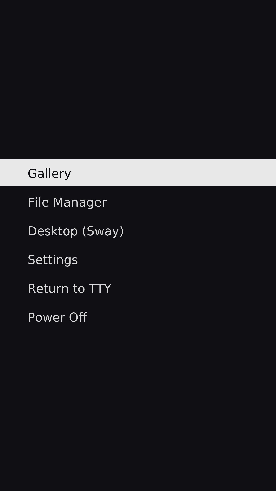 | 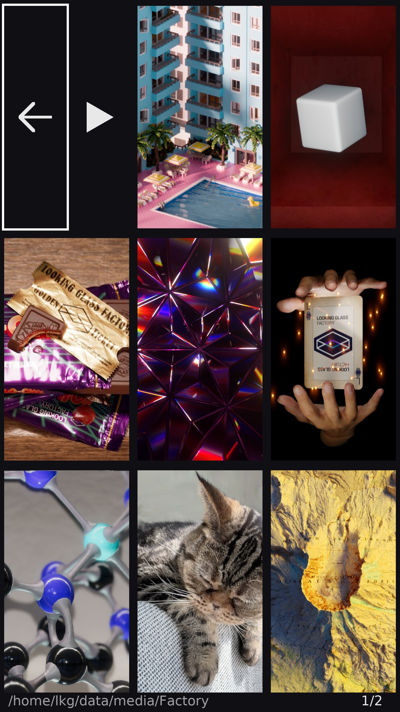 | 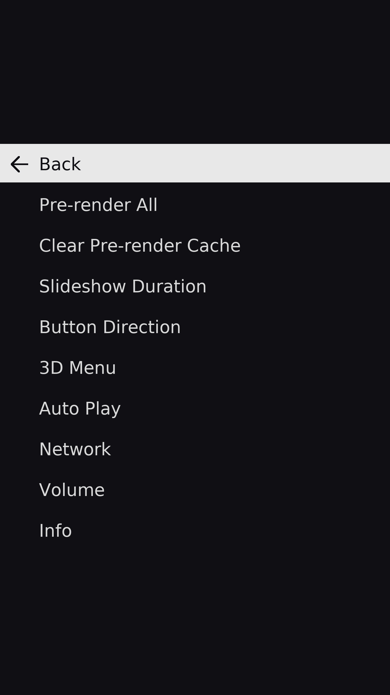 |

| Info | Pre-Render | Desktop (Sway) |
|------|---------|----------|
| 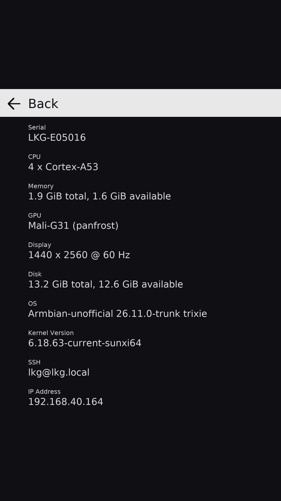 | 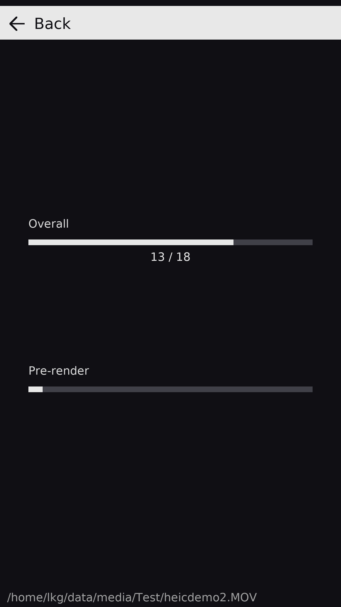 | 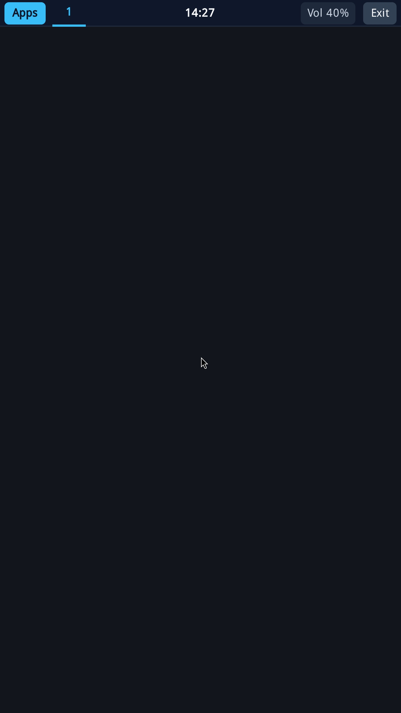 |

## AI usage

This firmware builder, its system scripts, patches, and companion applications are developed primarily with AI assistance and tested on real Looking Glass Go hardware, with human design review and verification.

This repo contains only additional files applied to mainline Armbian to keep everything simple. But after all, it's vibe-coded. Don't use it if you don't trust it.

## Install

### Back up your existing data

All the data inside your Looking Glass Go is stored on an SD card. The safest way to keep your original system and data intact is to simply use a separate SD card. If you want to extract your existing media from the device first, start on a PC.

You need a Windows PC or a virtual machine — macOS won't work (not even with OpenMTP). Connect the device and press the power button to start it. It doesn't matter whether it shows any images; make sure the device boots into connected mode (indicated by a blinking blue LED, not breathing).

Wait a moment until a removable drive appears on your PC. Back up all your images along with their companion JSON files (the playlist file is optional).

### Disassemble the device

Disconnect power, remove the screws shown below, and open the back cover. There are sticky thermal pads inside, so it takes a bit of effort. Inside, you'll find the SD card slot. Push the card in to pop it out.

| Screws | PCB |
|---|---|
| 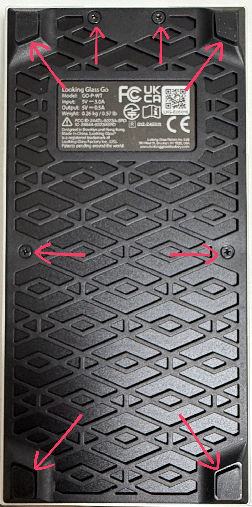 | 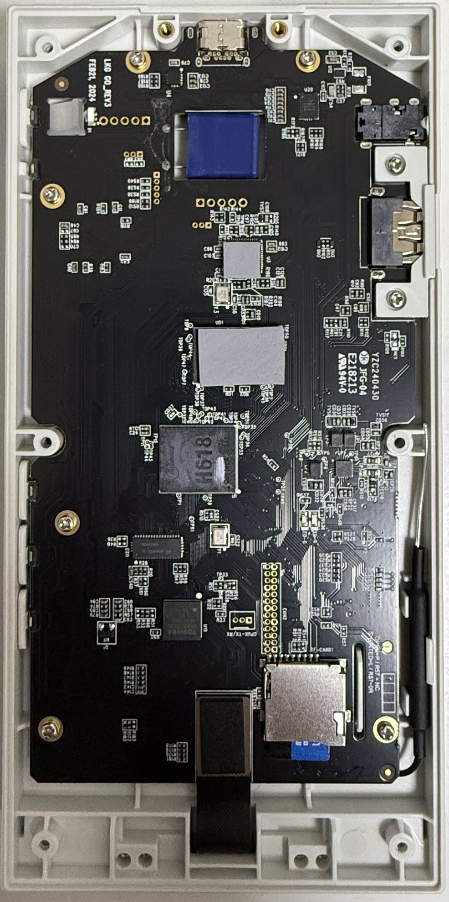 |

### Flash the image

The easiest way to flash the image is with [Etcher](https://etcher.balena.io/). Grab a blank SD card (at least 16 GB) and use Etcher to flash the image downloaded from the "Releases" page of this repository.

### First boot

Insert the SD card and connect the device to a regular power adapter (don't use a PC this time so you can watch the boot process). Press the power button to turn it on.

After some LED blinking, the screen should light up with scrolling boot logs. The first boot takes longer than usual (it expands partitions and sets up storage). Once finished, you'll be greeted by the main menu.

## Usage

### Buttons

The power button works just like on the stock firmware: press once to boot, press again after booting to toggle external display mode, and long-press to shut down.

The media buttons work a little differently. I found reversing the Next/Prev direction more intuitive, though you can disable this in Settings.

Next/Prev moves the cursor between items, Play/Pause confirms your selection, and long-pressing Play/Pause exits the current screen (for example, to leave the player).

### Transfer files

Connect the device to a PC or Mac in external display mode (blue LED). First, you'll see a drive called `LKG-XXXXX`, which holds device calibration data. After a short wait, a second drive called `LKG_DATA` will appear. Copy your images along with their JSON files into a folder named `media` (create it if it doesn't exist). Nested folders are supported.

You can also use the "File Manager" feature: open the shown URL and upload files through the WebUI. Just make sure to leave the "File Manager" screen open while uploading.

## Gallery

The gallery view is a better replacement for the original slideshow feature.

| Folders | Generating Thumbnails | Pre-Render |
|---------|-----------------------|------------|
| 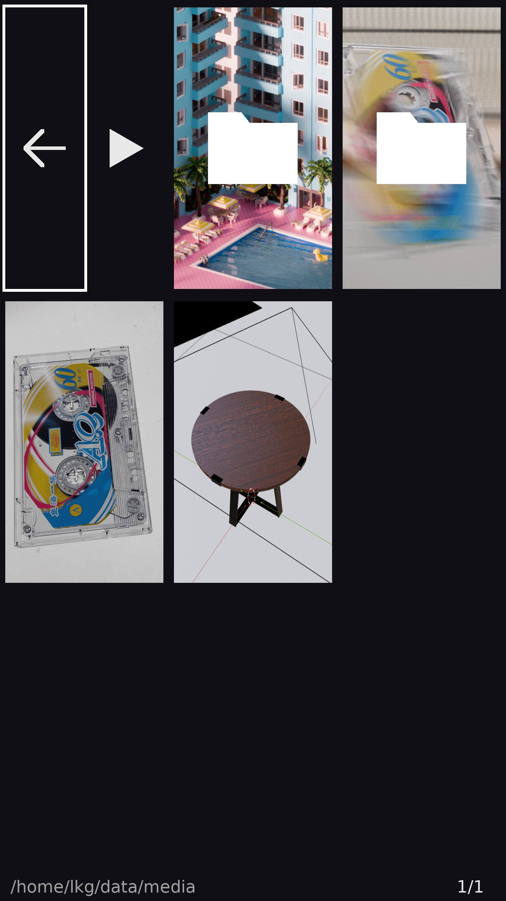 | 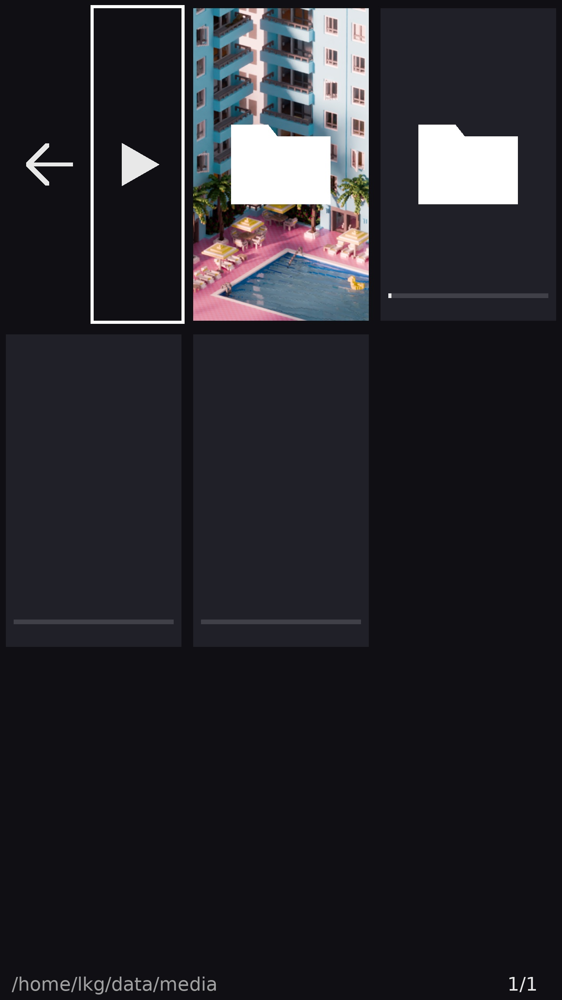 | 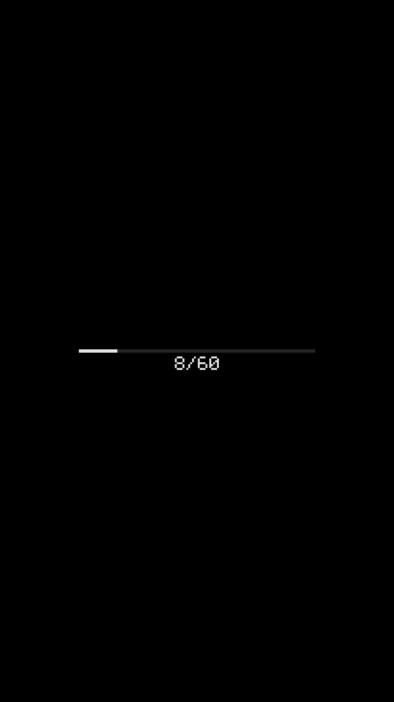 |

The gallery mirrors the directory structure inside your `media` folder. If you plug in a USB drive, it also shows up as a folder.

Opening an individual file plays it. Use Next/Prev buttons to switch to the next or previous item, without auto-advancing like a slideshow. To start a slideshow, use the play button in the top-left corner. A slideshow includes all files across nested folders.

All 3D media needs to be pre-rendered before playback. To avoid waiting, use the "Pre-render All" feature in Settings.

Long-press the Play/Pause button to stop playback.

## Advanced

The image enables `overlayroot` automatically, so changes to the system partition won't persist across reboots. You can disable it in `armbian-config`.

To SSH into the device, connect to `lkg@lkg.local` (default password: `nano`).

## Custom Build

```sh
git clone https://github.com/megabitsenmzq/OpenGlass-Go-Builder.git
cd OpenGlass-Go-Builder
./build.sh --clean --compress
```

The build initializes the `apps` submodule automatically, downloads and verifies remaining dependencies, compiles the applications and system image, runs static verification, and writes outputs to `dist/`.

### macOS

Install Lima first:

```sh
brew install lima
```

`build.sh` creates or reuses the `lkg-build-2604` ARM64 VM defined in `lima/lkg-build.yaml` (default: 8 CPUs, 8 GiB RAM, 80 GiB disk; 16 GiB+ host RAM recommended — adjust `lima/lkg-build.yaml` on smaller Macs). Use `--vm NAME` or `LKG_VM_NAME` to select another instance.

### ARM64 Debian/Ubuntu Linux

Run `./build.sh` directly. Missing host packages are installed with `apt-get` (`sudo` may be required). Reserve approximately 40 GiB for sources, caches, the application chroot, and outputs.

x86-64 support later.

## Build options

```sh
# Rebuild everything and discard previous sources and caches
./build.sh --clean

# Build and create an xz-compressed release image
./build.sh --clean --compress

# Rebuild only the applications and update an existing full image
./build.sh --apps-only

# Collect an existing VM build without starting another one
./build.sh --resume
```

- `--apps-only` requires a previous full build in the selected workspace and skips rebuilding Armbian and the kernel.
- Downloads are cached in the build workspace and reused on subsequent builds. A checksum mismatch aborts the build.
- Environment overrides: `LKG_DUFS_ARCHIVE_URL`, `LKG_RTL8723DS_FW_URL`, `LKG_RTL8723DS_CONFIG_URL` (mirrors/local verification), `LKG_USER_PASSWORD`, and `LKG_ROOT_PASSWORD`.

## Outputs

```text
dist/OpenGlassGo-trixie-current-6.18.63-overlay-data.img
dist/OpenGlassGo-trixie-current-6.18.63-overlay-data.img.sha256
dist/OpenGlassGo-trixie-current-6.18.63-overlay-data.packages.txt
dist/build-manifest.txt
dist/app-sources.sha256
dist/app-build-packages.txt
dist/build.log
```

With `--compress`, `.img.xz` and `.img.xz.sha256` are also generated. `scripts/verify-image.sh` mounts the generated root filesystem read-only to verify storage setup, enabled services, binaries, dynamic libraries, and license notices. Static verification does not replace on-device testing.

## Packages and licenses

This image combines Armbian, mainline Linux `6.18.63`, mainline U-Boot `v2026.10`, ARM Trusted Firmware `lts-v2.14.11`, Debian `trixie`, `dufs`, RTL8723DS Bluetooth firmware, and the native apps from [`apps/`](./apps) ([OpenGlass-Go-Apps](https://github.com/megabitsenmzq/OpenGlass-Go-Apps)).

See [`third_party/README.md`](./third_party/README.md) for the complete list of upstream components, pre-installed Debian packages, and their licenses, and [`versions.lock`](./versions.lock) for pinned commits and SHA-256 checksums.

## Disclaimer

This project is an independent, unofficial third-party firmware and image builder. It is **not affiliated with, endorsed by, sponsored by, or supported by Looking Glass Factory** or the official Looking Glass Go software/firmware team.

All product names, trademarks, and registered trademarks (including "Looking Glass" and "Looking Glass Go") are the property of their respective owners and are used strictly for compatibility and identification purposes.

This software is provided **"AS IS"**, without warranty of any kind, express or implied. Flashing or running third-party firmware may void your device's warranty and carries inherent risks (including data loss or hardware malfunction). You assume full responsibility for any risks associated with building, installing, or using this software.

If you redistribute compiled binary images built by this repository, you are responsible for complying with all applicable third-party license and redistribution obligations (including GPL/LGPL corresponding source availability, Debian package copyright notices, and Realtek Bluetooth firmware terms).

## License

The original build scripts, board configuration, systemd units, BSP helpers, and original scripts in this repository are licensed under the **[GNU General Public License v3.0 or later (GPL-3.0-or-later)](https://www.gnu.org/licenses/gpl-3.0)**. See [`LICENSE`](./LICENSE).

Third-party projects, upstream patches modifying GPL-2.0 components (such as Linux and U-Boot), Debian packages, and firmware blobs retain their own licenses as listed in [`third_party/README.md`](./third_party/README.md).
